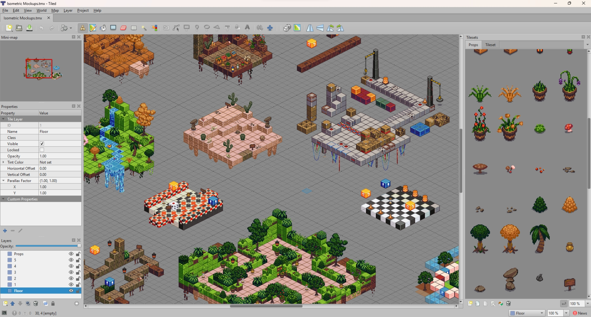
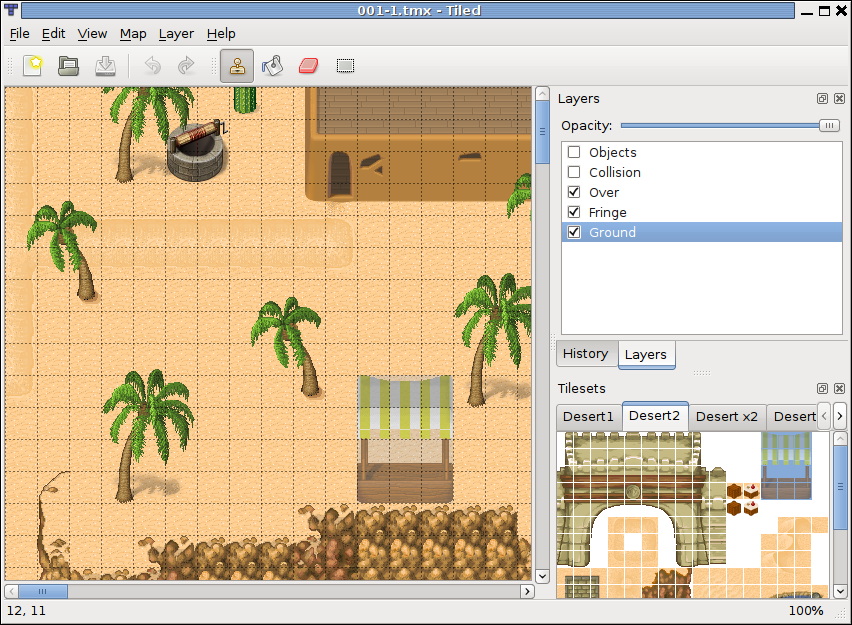
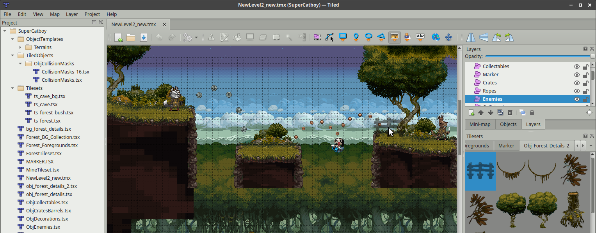

# Tiled Turns Tile Artwork into Structured Game Worlds

Tiled Level Editor gives a level both a visual layout and information a game can read. Paint scenery, place gameplay objects, attach typed properties, and keep the editable source connected to the format your runtime expects.

[](https://tiled-level-editor.github.io/Tiled-Editor/)

## Prove the route from map to game

Use a small representative room to test the complete content pipeline. Include a tile layer, an external tileset, one object layer, and a property that your game actually reads.

The editor can author more information than every importer understands.
Verify the target library's support before building a large map around a particular feature.

For an existing TMX map, these native CLI commands produce JSON and Lua exports:

```bash
tiled --export-map json harbor.tmx harbor.json
tiled --export-map lua harbor.tmx harbor.lua
```

These commands assume that Tiled is available as `tiled`.
The input map and its referenced assets must exist; the output names are examples you choose.

Keep the editable map as the authoring source. Treat exported files as outputs of that source, with a repeatable way to regenerate them.

The supplied [tiled.1.ronn](man/tiled.1.ronn) documents the export command.
The [export-format documentation](https://doc.mapeditor.org/en/stable/manual/export/) explains supported targets and export options.

On Linux, automated export can still need a display server.
Follow the documented Xvfb approach when the build environment has no display.

Check version-specific behavior in [NEWS.md](NEWS.md), distinguishing released changes from entries marked Unreleased.

## Make the tileset reusable before painting everything

A tiled map editor workflow becomes easier to maintain when several maps share the same tileset definition.
Save a reusable tileset externally so its metadata stays consistent across the maps that reference it.

An image-based tileset cuts a regular grid from one image. Set the tile dimensions, margin, and spacing to match that image.

An image collection tileset instead lets individual tiles refer to separate images. Choose it when the artwork does not fit a uniform sheet or when texture packing happens later.

### Preserve the meaning of a tile

Artwork and metadata travel together.
A tile may carry collision shapes, animation frames, custom properties, or terrain information.

- Check that the sheet is sliced at the correct boundaries.
- Inspect drawing offsets for artwork that extends beyond its cell.
- Keep tile identifiers stable when revising a shared asset.
- Confirm that the game importer reads the metadata you use.
- Test a changed tileset in more than one map.



The tiled tileset editor also previews tile animations.
Frame durations and collision geometry still need to be interpreted correctly by the runtime.

The [tileset manual](https://doc.mapeditor.org/en/stable/manual/editing-tilesets/) describes these editing tools.
Changing a tile's picture is different from confirming how that tile behaves inside a game.

## Give objects a clear gameplay meaning

An object layer can hold information that is awkward to represent as a painted tile. Use shapes and points to describe where something happens, then let your game assign the behavior.

| Level concept | Suitable representation | Example metadata | Runtime responsibility |
|---|---|---|---|
| Player entry | Point object | Entry identifier | Choose the spawn position |
| Exit zone | Rectangle object | Destination map | Trigger a transition |
| Irregular obstacle | Polygon object | Collision category | Create collision geometry |
| Placed decoration | Tile object | Variation identifier | Render the chosen tile |

These are project conventions, not built-in gameplay rules.
A rectangle called Exit does not change scenes until your game implements that behavior.

### Store values with their intended types

Create properties through the Properties view and choose types deliberately.
A numeric difficulty and a boolean switch are easier to consume consistently than strings containing similar text.

This TMX XML fragment illustrates properties on a map or object that supports them:

```xml
<properties>
  <property name="destination" value="harbor-east"/>
  <property name="difficulty" type="int" value="2"/>
  <property name="requiresKey" type="bool" value="true"/>
</properties>
```

The names belong to this example's game design. The fragment is part of a larger TMX document, not a complete map file.

Use [custom properties](https://doc.mapeditor.org/en/stable/manual/custom-properties/) for the editor-side types.
Consult the [TMX reference](https://doc.mapeditor.org/en/stable/reference/tmx-map-format/) when implementing the loader.

Custom classes can group related properties with defaults.
Define them in the Tiled project so collaborators use the same vocabulary.

## Choose the right kind of painting automation

Terrain painting and Automapping both reduce repetitive work, but they describe different rules. Select the mechanism around the relationship you want to express.

### Connected ground and borders

Terrain Sets annotate tile corners, edges, or both.
The Terrain Brush uses those markings to choose transitions as you paint.

A corner set fits corner-based transitions.
An edge set suits connections along tile sides.
A mixed set uses both and can require a larger collection of patterns.

Check missing combinations with a small test patch before painting a whole region.
The [terrain guide](https://doc.mapeditor.org/en/stable/manual/terrain/) explains how the markings drive tile selection.

### Patterns that place other content

Automapping searches for input patterns and places the corresponding outputs.
It can express relationships beyond a simple transition between neighboring terrains.

An example rules list could contain:

```text
[harbor*]
rules/pier-edges.tmx
rules/crate-details.tmx
[*]
rules/common-markers.tmx
```

These paths illustrate rule maps you would create for your project; they are not files included in this collection.
The first two maps apply to matching harbor filenames, while the last rule map applies after the filter returns to all filenames.

Each rule map needs correctly named input and output layers.
Check the [Automapping documentation](https://doc.mapeditor.org/en/stable/manual/automapping/) before designing the rule maps.

For custom compiled extensions, [TiledPlugin.qbs](qbs/imports/TiledPlugin.qbs) defines the plugin build product.
The separate [PythonProbe.qbs](qbs/imports/PythonProbe.qbs) locates Python build dependencies for the optional Python integration.

## Expand the world without hiding its assumptions

Choose orthogonal, isometric, staggered, or hexagonal geometry to match the project.
The map's geometry affects coordinates, rendering, and the assumptions an importer must make.

A large tiled map can use an infinite map layout. A world can instead organize several map files into a larger arrangement.

Decide how the runtime will load areas before splitting the content.
Map boundaries, neighboring exits, and asset references need a consistent convention.



When evaluating tiled godot workflows, check the documented Godot export path against the Godot version and features you use.
An importer or exporter may support only part of the information visible in Tiled Editor.

For another engine, test its Tiled integration with the same representative room.
Compare object positions, layer order, tile transforms, and collision shapes inside the running game.

## Review a picture and the playable result

A rendered image is useful for composition reviews, issue reports, or a map overview.
It complements a runtime test because the image cannot demonstrate triggers, collision response, or scene transitions.

The companion rasterizer can make a preview while excluding a layer named Collision:

```bash
tmxrasterizer --size 1024 --hide-layer Collision harbor.tmx harbor-preview.png
```

This fits the output inside a 1024-by-1024 square rather than forcing a square image.
It assumes that `tmxrasterizer` is included in your package and available on the command path.

The [tmxrasterizer.1.ronn](man/tmxrasterizer.1.ronn) source documents preview options.
The [tmxviewer.1.ronn](man/tmxviewer.1.ronn) describes the separate lightweight map viewer.



Before approving a level, check:

1. Tile transitions and decoration remain readable at the game's scale.
2. Object positions match the intended origin and coordinate system.
3. Every exit has a valid destination.
4. Collision shapes match the paths the player can actually take.
5. Required tilesets and images remain available after moving the project.

For desktop thumbnails, [tiled.thumbnailer](mime/tiled.thumbnailer) connects file previews to the rasterizer.

## Keep the same project usable across machines

Preserve relative relationships between maps, tilesets, images, and file properties.
A map that opens on one computer can still fail elsewhere if it depends on an asset outside the shared project.

Desktop integration and application packaging are separate from level content:

- [org.mapeditor.Tiled.xml](mime/org.mapeditor.Tiled.xml) defines MIME types and filename patterns.
- [org.mapeditor.Tiled.desktop](org.mapeditor.Tiled.desktop) registers the desktop launcher and supported file types.
- [org.mapeditor.Tiled.appdata.xml](org.mapeditor.Tiled.appdata.xml) supplies application metadata.
- [snapcraft.yaml](snap/snapcraft.yaml) describes the Snap package.
- [tiled.desktop](snap/gui/tiled.desktop) supplies its launcher entry.

For portable runtime layout, inspect the Linux [AppRun](dist/linux/AppRun) entry point and [qt.conf](dist/linux/qt.conf).
The Windows [qt.conf](dist/win/qt.conf) configures plugin and translation paths, while [fixup-install-names.rb](dist/macos/fixup-install-names.rb) adjusts macOS bundle library references.

Windows packaging is described by [installer.wxs](dist/win/installer.wxs) and [installer.qbs](dist/win/installer.qbs).
Those files package the editor; your game needs its own rules for distributing map assets.

## Carry useful evidence into an editor change

A small map that reproduces a problem is more actionable than a full game project. Include the necessary tileset and image references when reporting unexpected editor behavior.

Follow [CONTRIBUTING.md](CONTRIBUTING.md) for the expected report details.
State the Tiled version, operating system, steps, expected result, and actual result.

For source contributors, [TiledQtGuiApplication.qbs](qbs/imports/TiledQtGuiApplication.qbs) centralizes GUI application build settings.
The [TiledTest.qbs](qbs/imports/TiledTest.qbs) product defines test dependencies, and [Doxyfile](Doxyfile) configures source API documentation.

Review [LICENSE.GPL](LICENSE.GPL) and [LICENSE.BSD](LICENSE.BSD) for the supplied software license texts.
This collection contains selected Tiled documentation and packaging materials, not a complete editor checkout or a playable map project.

## Related Search Terms

Tiled Level Editor, Tiled Editor, tiled map editor, tiled map, tiled tileset editor, level-editor, map-editor, game-development, tilesets, tile, editor, qt, c-plus-plus, game, open-source
